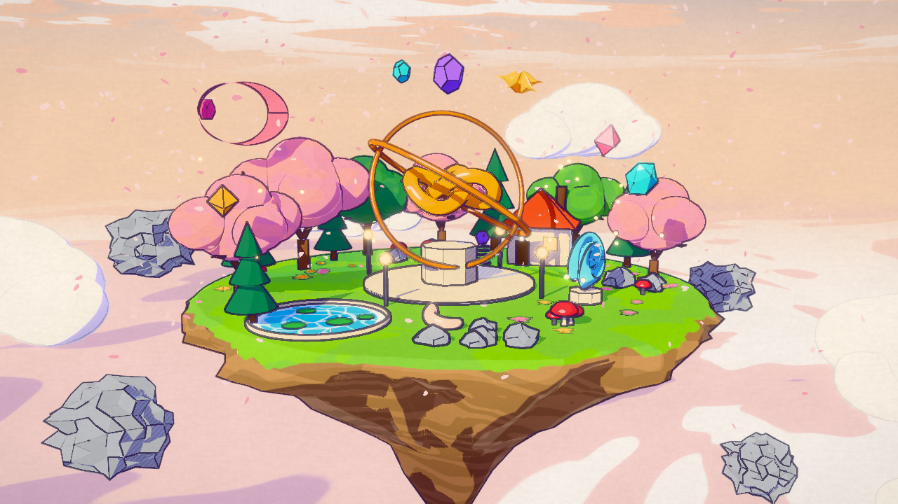

# mu_new

A small Vulkan 1.3 layer (`vk.h`, implemented in `vk.c`) and a toon renderer
written against it (`main.c`). The window, keyboard and mouse come through
`platform.h`.

## Build and run

Linux with X11 or Wayland, a C11 compiler and `make`. Vulkan is loaded at run
time through volk and GLFW is built from `external/glfw`, so nothing else is
linked.

    make              # ./toon for X11
    make WAYLAND=1    # ./toon for Wayland only, without libdecor
    make run          # window
    make shot         # ./toon --shot toon.png, no window or display needed
    make check        # builds ./smoke, an end-to-end test of vk.c, and runs it twice

Run from the repository root: shaders are found by relative path.

    ./toon [--shot out.png] [--width N] [--height N] [--msaa 1|2|4|8] [--frames N]
           [--orbit DEG] [--elevation DEG] [--seconds N] [--validate 0|1] [--stats 0|1]

In the window: drag or arrow keys orbit, `O` ink lines, `B` bloom, `H` hatching,
`P` paper, `Space` pause, `F2` writes `toon_shot.png`, `Esc` quits.

- `--shot` renders `--frames` frames (default 8) without a window and saves the
  last one. Each frame is one 60 Hz step, so the same command gives the same file.
- `--orbit`, `--elevation` and `--seconds` set where the camera and the clock start.
- `--msaa`: every Vulkan device has 1 and 4; 2 and 8 depend on the device, and
  the program stops with a message that lists the device's own if it lacks the
  one asked for.
- `--validate 1` (the default) turns the Khronos validation layer on when it is
  installed. Any error it reports is printed. Errors up to the last frame make
  the exit code 1; errors during teardown are only printed.
- `--stats 1` prints per-pass GPU times, counters and notes on exit, and the
  scene pass split into objects, petals and sky.

### X11 or Wayland

`./toon` is built for one window system. `WAYLAND=1` picks Wayland, and has to
go with every `make` command (or `export WAYLAND=1` once): a `make` without it
rebuilds for X11. It sets two compile flags:

- `-D_GLFW_WAYLAND` instead of `-D_GLFW_X11` for GLFW's sources. Only GLFW's
  Wayland backend is compiled: the program contains no X11 code, reads no X11
  header and opens no X11 library. (A Vulkan driver may still load libxcb for
  its own use; Mesa's does.)
- `-DPLATFORM_NO_LIBDECOR` for `platform.c`, which then tells GLFW not to load
  libdecor. The window frame is drawn by the compositor where it offers to
  (sway does), and is a plain one drawn by GLFW where it does not (weston).
  GLFW 3.6 has no switch that compiles its libdecor code out: that code is
  still in the binary, and never runs.

| | to build | at run time |
|---|---|---|
| X11 | X11, Xrandr, Xinerama, Xcursor, Xi and Xext headers | the libraries of those |
| Wayland | `wayland-scanner`, wayland-client and xkbcommon headers | libwayland-client, libwayland-cursor, libwayland-egl, libxkbcommon |

`--shot` and `./smoke` need no window system in either build.

### Shaders

The shaders are Slang (`shaders/*.slang`, sharing helpers from
`external/mu_lib/mu/shaders`). `shader_load` compiles an entry point with
`slangc` (or `$SLANGC`) into a `.spv` next to the source, and again whenever a
`.slang` file in that directory is newer. The compiled `.spv` files are checked
in, so the demo runs without Slang installed; it then says once that edits to
`.slang` files are not picked up. `MU_SHADER_REBUILD=1` forces a rebuild.

## Files

| | |
|---|---|
| `vk.h` | the API. Added to the header as it was given: `gpu_resize()`, `image_sub_sampled_id()`, `image_sub_storage_id()`, `attach_depth_read()` with `Attach.read_only`, `set_viewport()`, `set_scissor()`, `pass_note()` with `PassNote`, `pass_scope()` with `ScopeStat`, `FrameStats.state_runs`, `GpuInfo.sample_counts`, `ImageDesc.frame_shift` and images without a size |
| `vk.c` | its implementation: one file, 13 sections, in dependency order |
| `main.c` | the toon renderer; everything is in `main()` |
| `platform.h` | one window and what the user does to it: create, poll, the input state, the size, the Vulkan surface |
| `platform.c` | `platform.h` on GLFW, and the only file that includes GLFW; keys and mouse reach the program as a `mu_input` state |
| `shaders/` | `scene` (cel shading, shadow, petals), `sky`, `frame` (bloom, ink, composite), `compute` (paper, petal simulation), `shared` (the ABI) |
| `tests/smoke.c` | headless test of the `vk.h` API: buffer and image uploads, mips, a mip drawn from the one above it, a mip written by compute, MSAA resolve, a depth-only pass, depth tested and sampled in one pass, viewport and scissor, compute, indirect draws and dispatch, readbacks, arenas, handle reuse, images that follow the frame, stats, notes and scopes |
| `Makefile` | `toon`, `smoke`, `run`, `shot`, `check`, `clean`; `WAYLAND=1` |
| `external/` | vendored: `mu_lib` (https://github.com/abhinavpatel00/mu_lib- at `b1d750c`), GLFW 3.6.0, volk, the Vulkan headers |

## The frame

    paper      compute   once: the paper texture the composite draws on
    petals     compute   falling petals, simulated in place in the device arena
    shadow     graphics  sun depth, 2048x2048
    scene      graphics  4x MSAA, three targets resolved in the pass:
                         HDR colour, normal + depth, outline id + ink weight
    bloom      graphics  four levels down, three additive levels up; the levels
                         are the mips of one image
    composite  graphics  ink lines, bloom, tone map, grade, paper, sRGB

Cel bands are cut with screen-space derivatives so every band edge is one pixel
wide at any distance. Shadows and the light terminator are the same edge. Ink
lines come from three detectors (depth curvature, normal creases, object ids)
and each material sets how heavily it is inked. Meshes are all from
`mu_shapes`; the scene is tables in `main.c`.

## What vk.c decides where vk.h leaves it open

- **Geometry is pulled, not bound.** `draw_indexed(pass, push, n, instances)`
  draws `n` vertices; the vertex shader reads its index and vertex from binding
  3, which is the whole `ARENA_DEVICE` buffer, at byte offsets the application
  passes in the push constants. Other buffers are reached by device address
  (`buffer_info().address`).
- **Bindings**: 0 sampled images, 1 samplers, 2 storage images, 3 the device
  arena. Index 0 of the image and sampler arrays is a 1x1 white dummy.
  `image_sampled_id()` reaches every mip of an image, and Vulkan wants all of
  them readable while it is used. A pass that renders into one mip and reads
  another (bloom does) reads through `image_sub_sampled_id()`, the index of
  that one mip. A storage index reaches one mip only, the first of its range:
  `image_storage_id()` is mip 0, and a compute pass that writes mip n takes
  `image_sub_storage_id()` of that mip. An image can be reached through 16
  ranges, enough for the whole image and each of its mips.
- **Conventions**: clip +Y is up and uv (0,0) is the top-left texel; counter-
  clockwise is front; the `draw_state_*` presets are reverse-Z (depth clears to
  0, compare `GREATER`). The frame image is 8-bit UNORM, so the last pass writes
  display-encoded colour.
- **Read-only depth**: `attach_depth_read()` attaches depth that is tested and
  never written. Depth writes are off in that pass whatever the `DrawState`
  says, nothing is stored back, and the image is in the layout a sampled depth
  image has. A pass that also lists it with `use_sampled()` can therefore test
  against it and sample it, without a feedback loop.
- **Viewport and scissor**: a graphics pass begins with both covering all of
  it. `set_viewport()` and `set_scissor()` replace them until the pass ends, in
  pixels from the top left; inside the viewport the conventions above hold.
  The scissor is cut down to the pass, so a UI can pass clip rectangles that
  start off screen. Setting what is already set emits nothing.
- **Pipeline cache**: what the driver compiled is kept between runs in
  `$XDG_CACHE_HOME/<name>/pipelines-<vendor>-<device>.bin`, or under `~/.cache`
  when `XDG_CACHE_HOME` is not an absolute path. `<name>` is `GpuDesc.name`
  with everything but letters, digits, `-` and `_` turned into `_`: `mu_toon`
  for the demo, `smoke` for the test. `gpu_create` loads the file. `gpu_destroy`
  writes it when the run compiled a pipeline the file did not have, so a
  program has to reach `gpu_destroy` for anything to be kept. The file begins
  with a header of this backend's own: vendor, device, driver version, the
  driver's `pipelineCacheUUID`, pointer size, and the size and a hash of the
  driver's bytes. Unless all of it matches, the driver is given nothing, one
  `vk: note:` line says so, and the run compiles from nothing and replaces the
  file. The file is replaced by a rename, so two instances or a crash cannot
  leave half of one. Without a usable `HOME` or `XDG_CACHE_HOME`, or when the
  directory cannot be written, a note says so and nothing is kept. The file
  only grows: the driver's data keeps pipelines of shaders that no longer
  exist. Deleting it costs one slow start.
- **Sync**: a pass declares what it reads and writes and gets one barrier call.
  Data written by an upload needs no declaration afterwards.
- **Timeline**: one submit per frame, numbered by a timeline semaphore; destroyed
  resources, staging memory and readbacks are retired against it.
- **Present**: the semaphore a present waits on belongs to the swapchain image
  and is indexed by the acquired image index. The one the acquire signals
  belongs to the frame slot. A swapchain's semaphores are destroyed after it.
- **Size**: an X11 surface has the window's size, and the frame image follows
  it without being told. A Wayland surface has no size of its own: the frame
  image takes the one given to `gpu_resize()`, which the demo calls every frame
  with `platform_size()`. On X11 that call does nothing.
- **Images that follow the frame**: an image created without a width and a
  height is as large as the frame. `ImageDesc.frame_shift` halves that size so
  many times, down to one pixel, and of the mips asked for the image has the
  ones its size has. When the frame changes size the backend builds every such
  image again in its slot: the handle and the shader indices stay as they are,
  what the image held is gone, and a view of a mip the new size does not have
  goes together with its indices. That happens where the swapchain is rebuilt,
  inside `frame_begin()` and `gpu_set_surface()`, with the queue idle: never
  between `frame_begin()` and `frame_end()`. The old image is freed through the
  timeline like a destroyed one. The demo's eight frame-sized targets and its
  bloom image are made this way, once, and `main.c` has no resize code. A
  headless frame never changes size. A debug name is kept up to 47 characters.
- **Stats**: `FrameStats.state_runs` counts the stretches of draws that share
  pipeline, state, viewport and scissor, which is the unit a state change is
  paid for in; `gpu_dump_stats()` prints it beside the draw count. `pass_note()`
  puts what the application knows about a pass (samples per pixel, workgroup
  shape) in that pass's row. A note is printed, never checked.
  `GpuInfo.sample_counts` is the sample counts an attachment can have.
- **Scopes**: `pass_scope()` names a stretch of a pass and charges it the GPU
  time up to the next scope or to `end_pass()`: a row of `FrameStats.scopes`,
  printed under its pass. What a pass does before its first scope and as it
  ends (clear, resolve, store) is in no scope. A frame keeps 64 scopes.
  Timestamps take a frame's queries in the order they are written, and inside
  a pass with a view mask one query for each view, as Vulkan counts them.
- **Failure**: setup failure is fatal where it happens, with a message that says
  what failed. `gpu_error()` holds the last validation error.
- **Requires** Vulkan 1.3 with dynamic rendering, synchronization2, timeline
  semaphores, buffer device address, descriptor indexing and 256 bytes of push
  constants. `VK_EXT_extended_dynamic_state3` is used when present;
  `MU_NO_EDS3=1` forces the fallback.

## Tested

On Mesa lavapipe 25.0 (a CPU Vulkan driver), with gcc 14 and clang, under two
validation layers: Debian's 1.4.309 and the Vulkan SDK's 1.4.363.1
(`VK_LAYER_PATH=<sdk>/x86_64/share/vulkan/explicit_layer.d`).

- `./smoke` and `./toon --shot`, with the validation layer and with
  synchronization validation: no errors. The extended-dynamic-state path and
  the `MU_NO_EDS3=1` fallback give the same image, byte for byte.
- What that silence covers. Synchronization validation is on in those runs: a
  wrong barrier planted on an attachment is reported. It does not follow what
  a shader reads through the bindless arrays. A sampled image behind a barrier
  for the wrong stage, or in another layout than its descriptor says, is
  reported by neither layer, with or without GPU-assisted validation (both
  were planted). For those the test is the picture, and lavapipe draws the
  right picture whether layouts and barriers are right or not.
- `./toon` in an X11 window under Xvfb, driven with xdotool: resizes, keys
  (tapped, held, and held while the window loses focus), mouse orbit, `F2`,
  `Esc`, the close button: no errors. Only this run shows how the present
  semaphores are used, and only a layer from SDK 1.4.313 on checks it. An older
  layer says nothing whatever the code does.
- The Wayland build in headless sway 1.10, driven through a virtual keyboard
  and pointer: the same keys, drag, buttons and wheel give the same input as
  the X11 build; tiled, floating, resized, fullscreen and at output scales 1,
  1.5 and 2 the frame has the window's size in pixels; `F2`, `Esc` and the
  compositor's close request work: no errors. In weston 14, which has no
  server-side frames, it runs with GLFW's own frame.
- Both programs under AddressSanitizer and UBSan, in both builds.
- `pass_scope()`. `./smoke` checks the rows, the bounds (more scopes than a
  frame keeps, passes beyond `MAX_PASSES`), a frame without timing, and that
  the parts of a pass or a frame never take longer than the whole. A test
  program standing between `vk.c` and the driver counted the queries for
  passes with 1, 2, 3 and 6 views: a timestamp inside a pass takes one for
  each view, and none is used twice. What ends a pass stays out of its last
  scope: a pass with a 4x 1536x1536 resolve took 26 ms, its one scope 0.3 ms.
- The split between scopes is wrong on lavapipe, and that is the driver: it
  stamps a timestamp inside a pass while it rasterizes what follows. A light
  scope before a heavy one was charged 135 ms and the heavy one 3 ms. With a
  second timestamp written behind each of the backend's, which ends lavapipe's
  batch at once, the same frame gave 0.2 and 140 ms: the rows come from the
  right queries. No GPU was there to check the split on.
- Once a pass with a view mask has been drawn, lavapipe 25.0 spends one query
  for each view on timestamps outside a pass too, until a pass without one
  is drawn. With the fixed query slots the backend had before, a frame that
  ended on such a pass reported its first pass at 1.8e13 ms. Queries taken in
  writing order are out of that reach: the spare ones are written again later
  or never read.
- Images that follow the frame. `./smoke` checks what a run without a window
  can reach: the frame's size, the halving, one pixel where nothing would be
  left, the mips cut to the size, and that nothing is built again while the
  frame keeps its size. A headless frame cannot change size, so the rebuild
  itself is not in `make check`. It was tested with a hook in a copy of `vk.c`
  that gives the headless frame another size. The demo taken through twelve
  sizes down to 1x1, some of them changing one side only, ends on the same
  frame, byte for byte, as the code before, which destroyed and created its
  targets in `main.c`; at 4x and at 1x. A test program wrote and read a
  storage mip, a sampled mip, a depth image and an array layer through indices
  taken before a resize, saw the index of a mip that went away handed out
  again, and went through 300 sizes in a row. With a window, in X11 under Xvfb
  and in the Wayland build under headless sway 1.10: a test program read every
  such image back at exactly the size it must have, from headless to a window
  and back and through a dozen window sizes down to 20x12, 10x300 and 300x10;
  the demo resized the same way shows the right picture at the new size. The
  runs without a window were under both layers with synchronization validation
  and under AddressSanitizer and UBSan; the runs with a window under the
  1.4.363.1 layer with synchronization validation, and the X11 test program
  under the sanitizers too. Of 26 faults planted in the new code, 25 were
  noticed, 7 of them by `./smoke`. The one nothing notices is a wrong layout in
  a descriptor that is written again, which is the blind spot described above.
- The pipeline cache file, under the 1.4.309 layer. lavapipe puts nothing in a
  pipeline cache but its header, so there the file is 88 bytes: it is written
  once, left alone afterwards, and the images do not change. Real driver data
  was reloaded on RADV 25.0's device without a GPU (`RADV_FORCE_FAMILY=gfx1201`),
  which compiles pipelines but cannot draw. With Mesa's own disk cache off
  (`MESA_SHADER_CACHE_DISABLE=true`) the demo's ten pipelines take about 45 ms
  without the file and about 0.2 ms with it. 297 damaged or foreign files (cut
  short, header fields changed, bits flipped, noise) were all turned away with
  the note, under AddressSanitizer. Eight instances started together left one
  whole file.

Not tested: a hardware GPU, a driver that is not Mesa's, a Wayland session on a
real display, GNOME, KDE, Windows, macOS. `shader_load` runs the compiler
through POSIX calls. On lavapipe a 1280x720 frame takes about a third of a
second; that number says nothing about a real GPU.

In sway the demo stops drawing while its window is hidden (on another
workspace, say), and does not see a close request until it is shown again:
Mesa's vsync'd present waits for the compositor there. vkcube does the same.
